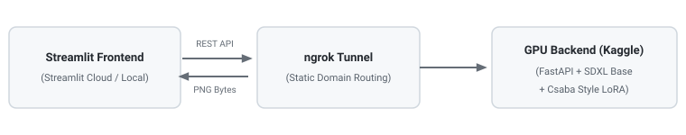

# 🎨 SDXL LoRA Custom Style Image Generator ("Csaba Style") - Integrated Project

A full-stack Generative AI web application combining a **Streamlit** frontend, a **FastAPI / ngrok** tunnel backend running on **Google Colab / Kaggle T4 GPU**, and a custom LoRA fine-tuned **Stable Diffusion XL (SDXL 1.0)** model trained on minimalist red-and-green MS Paint illustrations.

## 🔗 Live Links & References

- **Live Web Application:** [fcsaba-imagegenerator.streamlit.app](https://fcsaba-imagegenerator.streamlit.app/)
- **Hugging Face LoRA Model:** [fcsaba/csaba-style-sdxl-lora](https://huggingface.co/fcsaba/csaba-style-sdxl-lora)
- **Kaggle Backend Notebook:** [csabafarago/image-generator-backend](https://www.kaggle.com/code/csabafarago/image-generator-backend/)
- **Google Colab Testing Notebook:** [Colab Notebook Link](https://colab.research.google.com/drive/1vd9UPUVaORQM9mpMnuKEmLK14eCUHbt3)
- **GitHub Repository:** [faragocsaba/image_generator](https://github.com/faragocsaba/image_generator)

---

## ⚠️ Important Prerequisite

> **Note:** Because this application uses an on-demand Kaggle/Colab GPU backend to minimize hosting costs, **the backend notebook must be actively running** for image generation to work. If the session is offline, the Streamlit app will throw a connection timeout error.

---

## 🏗️ Architecture Overview



1. **Frontend:** Users input prompt descriptions and select generation parameters via the Streamlit interface.
2. **Tunneling:** Requests are routed through a static ngrok domain (`.ngrok-free.dev`) directly to the backend.
3. **Backend:** GPU executes inference using `stabilityai/stable-diffusion-xl-base-1.0` combined with the `fcsaba/csaba-style-sdxl-lora` adapter via Hugging Face `diffusers`, returning customized PNG image bytes.

---

## 📁 Repository Strategy & File Structure

The project has been unified under the **`faragocsaba/image_generator`** repository to maintain seamless integration with Streamlit Cloud.

```text
image_generator/
├── app.py                      # Streamlit frontend
├── image-generator-backend.py  # FastAPI backend for Kaggle execution
├── image_generator.ipynb       # Google Colab code notebook (executed)
├── requirements.txt            # Dependencies
└── README.md                   # Project documentation
```